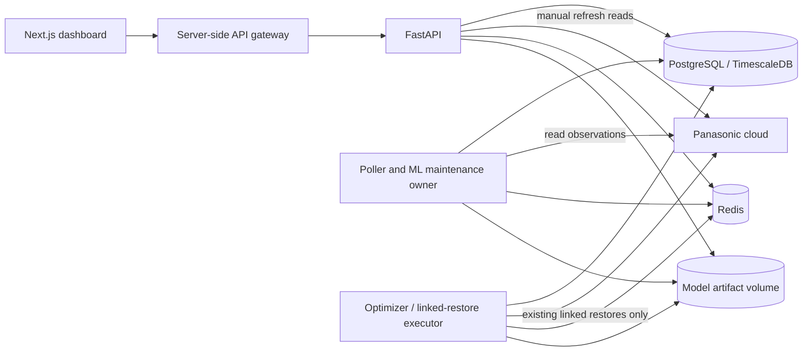

# Optimizer and dashboard architecture, code, and live UI review

**Review date:** 12 October 2026. Times in the narrative are Europe/Stockholm unless marked UTC.

**Scope:** `heatpump-optimizer`: Next.js dashboard, FastAPI routes, shared domain/configuration code, optimizer execution and planning, poller/model lifecycle, and relevant database constraints. The standalone Panasonic client library was excluded after the review scope was narrowed.

**Review policy:** Read-only inspection of application behavior and source. No settings were saved, reset was not submitted to the live installation, no device command or model training was initiated, and no service was deployed or restarted. This report, its offline verification helpers, JSON evidence, and screenshot are the only files created for this reporting task.

## Evidence and revision boundaries

There are three different evidence sets. They must not be treated as interchangeable.

| Evidence set | What was checked | Provenance and limits |
| --- | --- | --- |
| Initial source review | Current source including substantial uncommitted optimizer/dashboard changes | HEAD was `fa2c1e0`; the dirty working tree included the new restore ownership and model-readiness work. This was not a review of committed HEAD alone. No complete initial source manifest was captured. |
| Live browser pass | Home, Timeline, Under the hood, raw chart expansion, model diagnostics, safety activity filter, and all five Settings categories | Target: [http://localhost:4444](http://localhost:4444). Both UI and API version panels reported `0.15.0`; the forecast API contract shown was `2026-10-10.1`. A version number does not prove which Git revision or image is deployed. |
| Report-time source recheck | Finding locations and focused, isolated reproductions | HEAD: `5c437c1c129ce2c9daa5a75cc973d05cbd9b88f6`, branch `fix/phase2-safety-reverts`. Probes captured at approximately **14:46 on 12 October**, with exact UTC timestamps and source SHA-256 values in the evidence files. |

The checkout advanced during the review. Commit `406e3d8` at 14:05 introduced source remedies for the reset-error rendering and log-serialization findings. Commit `5c437c1` at 14:27 followed it. Those changes were made outside this reporting task. Findings F05 and F13 are retained as historical findings with verified source remedies; their fixes were not verified in the served installation.

Direct terminal HTTP probes could not connect to the target in the execution environment, and direct browser navigation to the API status endpoint was blocked by the browser client. Normal dashboard requests worked. These tool limitations are not evidence that the application was down. The live conclusions below are based on rendered UI, the UI's version panel, and its displayed application logs.

The saved Home screenshot was captured at **14:22:25 +02:00**. Its SHA-256 is `877d08180202145ed29576c11da779d47f95c8521d14cdd832b30ff8fe1f25c1`.

## Executive inventory

There are **15 numbered findings**: **2 P1**, **12 P2**, and **1 P3**. Thirteen still require remediation or verification work. Two have source remedies verified in focused offline checks, but neither is declared fixed in the live deployment.

Priorities mean:

- **P1:** A control-policy or safety-restore integrity defect requiring attention before control/executor promotion.
- **P2:** A functional failure, incorrect data presentation, or misleading operational conclusion.
- **P3:** A clarity or usability issue that can mislead users without demonstrating a control bypass.

| ID | Priority | Finding | Evidence | Status at source recheck |
| --- | --- | --- | --- | --- |
| [F01](#f01--positive-observation-can-be-bypassed-after-the-admission-wait) | P1 | A restore can start after observation becomes active | Actual executor/wrapper with fake DB, fence, clock, and device | Reproduced on current source |
| [F02](#f02--dashboard-freshness-ignores-known-measurement-clocks) | P2 | Dashboard freshness ignores remote clocks and accepts future rows | Offline clock reproduction; conflicting live labels | Reproduced; live disagreement needs a matched snapshot |
| [F03](#f03--saved-panasonic-credentials-do-not-reach-authenticated-wrappers) | P2 | Credential edits do not reach authenticated background wrappers | Offline wrapper reproduction | Reproduced on current source |
| [F04](#f04--plan-reset-omits-restrictive-dependent-records) | P2 | Plan reset omits dependent verification/shower records | ORM/migration inspection and in-memory FK reproduction | Reproduced at FK-contract level; PostgreSQL endpoint test pending |
| [F05](#f05--structured-reset-refusals-crash-the-original-ui) | P2 | Structured reset refusal was rendered as a React child | Original source/React reproduction; current helper/render check | Source remedy verified; served UI pending |
| [F06](#f06--invalid-timezones-pass-settings-validation) | P2 | Invalid IANA timezone can be persisted | Offline validator/consumer reproduction | Reproduced on current source |
| [F07](#f07--diagnostic-replanning-is-reported-as-plan-activation) | P2 | Diagnostic re-planning is reported as activation | Producer/consumer source contract | Still present; live button deliberately not pressed |
| [F08](#f08--home-reassures-users-when-comfort-cannot-be-assessed) | P2 | Home reassures users when comfort assessment is unavailable | Live screenshot and source branch | Observed live; source branch still present |
| [F09](#f09--valid-backend-statuses-appear-as-unrecognized) | P2 | Valid backend status codes appear as unrecognized | Live UI and actual mapper probes | Reproduced on current source |
| [F10](#f10--timeline-current-price-selects-the-last-future-point) | P2 | Timeline current-price caption uses the final future price | Live values and source-expression probe | Reproduced on current source |
| [F11](#f11--one-action-is-repeated-across-nearby-timeline-rows) | P2 | One action appears on multiple timeline sample rows | Live table and actual matching-expression probe | Reproduced on current source |
| [F12](#f12--rescheduling-resets-the-age-of-an-outstanding-restore) | P2 | Rescheduling hides the age of unresolved safety debt | Live changing times; fake-store update reproduction | Reproduced on current source |
| [F13](#f13--seasonal-cycle-reporting-raises-a-datetime-serialization-error) | P2 | Seasonal-cycle reporting/logging throws a datetime JSON error | Live log at 14:00:01; current log-processor probe | Source mitigation verified; actual served cycle pending |
| [F14](#f14--observe-only-messaging-still-promises-active-control) | P3 | Observe-only pages still promise active heating changes | Live settings/chart copy and source | Still present; messaging issue, not a proven write bypass |
| [F15](#f15--shower-rescheduling-erases-restore-admission-evidence) | P1 | Rescheduling erases drainage evidence but leaves a claim token | Actual update and admission logic with fake store | Newly confirmed while assembling this report |

The live freshness observation is included under F02 rather than counted twice. The live restore-history observation is split into F11 (duplicate presentation) and F12 (age reset), because they have different causes. F15 is a separate consequence of the rescheduler's metadata overwrite.

## Architecture assessment

The service split is appropriate for the application. The poller owns ingestion and model maintenance; the optimizer consumes durable re-plan requests and creates diagnostics; FastAPI serves the dashboard through the Next.js gateway. PostgreSQL/TimescaleDB provides shared authoritative records, Redis supports authentication breaker state and optional distributed read quotas, and model artifacts are shared through the model volume.



Useful foundations include durable jobs, UUID restore claims, PostgreSQL ownership fences, token-checked completion, model publication through compare-and-set, immutable artifacts, and the hard observe-only policy for ordinary writes. This review does not recommend replacing those mechanisms.

The main weakness is the number of independent interpretations of the same state. Observation authority, freshness, credential configuration, action history, model readiness, and UI labels cross several layers. F01 and F15 show that writers outside the immediate dispatch path can undermine the policy or its admission evidence. F02, F08, and F09 show that the dashboard can contradict the domain's evidence even while backend controls remain conservative.

Architectural improvements should concentrate on:

1. A shared admission contract for observation transitions and linked restores, including drainage and ownership preservation.
2. One canonical definition of measurement freshness, kept separate from credential availability, overall readiness, and the tighter freshness needed for a physical restore.
3. A defined configuration lifecycle: each setting is either applied live with a revision/invalidation mechanism or clearly labelled as requiring restart.
4. Typed API contracts for errors, forecast assessment states, and reporting status; positive UI claims should require positive evidence.
5. Explicit distinction between original obligation time, next retry time, physical dispatch time, and verified completion time.

## Verification modes

| Mode | Appropriate use | Boundary |
| --- | --- | --- |
| **LIVE-RO** | Read pages, expand diagnostics, change view filters, inspect existing logs, and compare displayed values | No setting save, reset submission, re-plan/training request, credential test, learning toggle, or device refresh during this review |
| **OFFLINE** | Included Python/Node probes, fake devices/sessions, in-memory SQLite, pure mapper/render checks | Python rejects real connections and uses an event loop without sockets. No real cloud, PostgreSQL, Redis, or model fitting is involved. |
| **DISPOSABLE** | Full endpoint regressions, reset/invalid-setting persistence tests, mocked browser mutation paths, PostgreSQL concurrency tests | Use an independently owned test DB/UI with synthetic credentials and fake Panasonic I/O. Do not point these procedures at the installation on port 4444. |

The disposable procedures below describe tests still to perform; they were not executed against the live installation. In particular, a production reset or forced learning transition is not a verification shortcut.

## Detailed findings

### F01 — Positive observation can be bypassed after the admission wait

**Priority/status:** P1; reproduced on current source. **Evidence mode:** OFFLINE.

The executor reads learning state at the start of preflight, then waits for the admission checkpoint. Subsequent authority checks validate the claim and PostgreSQL fence but do not re-read effective observation state. Enabling manual/seasonal observation during that wait therefore does not stop the impending restore call. The issue concerns a newly positive state after admission, not the intentionally restricted restore lane allowed when learning state is unknown.

**Source:** [preflight and dispatch](D:/apps/panasonic/aioaquarea/heatpump-optimizer/packages/optimizer/executor_core.py:455), [post-wait dispatch](D:/apps/panasonic/aioaquarea/heatpump-optimizer/packages/optimizer/executor_core.py:514), [authority check](D:/apps/panasonic/aioaquarea/heatpump-optimizer/packages/optimizer/executor_core.py:725).

**How to verify:**

1. Run the included backend helper and inspect `results.F01`.
2. Its valid linked Force DHW OFF restore starts with observation inactive.
3. The fake admission wait changes effective observation to active before SDK dispatch.
4. Inspect the mocked device call count and terminal action state.

**Observed signature:** `observation_active_before_dispatch=true`, `learning_checks=2`, `mock_device_writes=1`, `restore_status="executed"`; the mocked SDK call starts at 15.25 seconds. The real executor and wrapper run, but all DB, fencing, clock, and device I/O are test doubles. No physical command was sent.

**Acceptance criteria:** No new SDK write starts once positive observation is acknowledged. Activation must coordinate with admitted attempts so already-started external work is drained/reconciled rather than silently ignored. Recheck after admission/quota/authentication waits; preserve unknown-state policy, ownership fencing, and post-dispatch verification. Add regressions for activation before claim, after claim, during admission, during quota wait, and during authentication recovery. A recheck alone must not leave another unprotected activation-to-dispatch race.

### F02 — Dashboard freshness ignores known measurement clocks

**Priority/status:** P2; offline defect reproduced. The exact cause of the live cross-panel disagreement is not fully established. **Evidence modes:** OFFLINE and LIVE-RO.

The dashboard labels a status fresh from its locally persisted `ts`, although the same record can contain older remote measurement/retrieval clocks. Its simple freshness helper also accepts future timestamps. The canonical device-quality code rejects the stale evidence.

**Source:** [dashboard freshness](D:/apps/panasonic/aioaquarea/heatpump-optimizer/packages/api/routers/dashboard.py:172), [timestamp-only helper](D:/apps/panasonic/aioaquarea/heatpump-optimizer/packages/core/operational_alerts.py:60), [canonical clock validation](D:/apps/panasonic/aioaquarea/heatpump-optimizer/packages/core/device_data_quality.py:30).

**How to verify offline:** Run the backend helper and inspect `results.F02`. It constructs a row timestamped now, with measurement time one hour old and retrieval time now, using a 15-minute policy. It separately tests a future row timestamp.

**Observed signature:** Canonical readiness is false with `device_status_stale`, while `dashboard_fresh=true`; a future row also returns fresh.

**How to verify live:** Open Home → Heat pump details, then Under the hood → Diagnostics. Record both sample timestamps, ages, capture times, and stated thresholds in the same refresh window. During the pass Home said “Live readings,” while model diagnostics said “Live pump status is stale” and “Unavailable.” That is a confirmed presentation disagreement, not proof that either panel's reading is physically current. Current source now returns a compatibility `data_freshness` object when device-quality evidence is available; that does not repair the timestamp-only dashboard calculation.

**Acceptance criteria:** Stale, future, or misordered known clocks never produce a live label. Age reflects the oldest relevant known evidence, with documented inclusive boundaries. Separate freshness from overall `ready` status: missing credentials or a busy readiness snapshot should not be mislabelled as an old measurement. If two views intentionally use different thresholds, state that difference and its purpose.

### F03 — Saved Panasonic credentials do not reach authenticated wrappers

**Priority/status:** P2; reproduced on current source. **Evidence mode:** OFFLINE.

An already-authenticated wrapper returns before reading settings. A successful dashboard credential save can therefore leave background services using the old account/client and cached device. SDK authentication recovery can continue through that existing client as well.

**Source:** [authentication reuse](D:/apps/panasonic/aioaquarea/heatpump-optimizer/packages/core/services/aquarea.py:339), [settings persistence](D:/apps/panasonic/aioaquarea/heatpump-optimizer/packages/api/routers/settings.py:179).

**How to verify:** Run the backend helper and inspect `results.F03`. It starts an authenticated wrapper with an existing client, substitutes a reader for changed synthetic credentials, then calls `_ensure_authenticated()`.

**Observed signature:** `settings_reads=0`, `old_client_retained=true`. No real credentials are read or submitted.

**Acceptance criteria:** Detect a credential/configuration revision before reusing the client, and safely invalidate account/device caches. Coordinate changes with active restore ownership so an admitted action cannot switch accounts or devices midway through an attempt. Alternatively, explicitly make the setting restart-only and present that requirement after saving. Verify that all running service wrappers converge on the new revision, not only a newly created API wrapper.

### F04 — Plan reset omits restrictive dependent records

**Priority/status:** P2; FK contract reproduced; full PostgreSQL route behavior pending. **Evidence mode:** OFFLINE, then DISPOSABLE.

The `plans` scope deletes plan actions, plans, and overrides. Verification-read records reference actions with `ON DELETE RESTRICT`, and shower events can also retain restrictive action references. The unresolved-restore guard does not handle those references from otherwise completed history. A reset can fail with an integrity error after passing the explicit safety guard.

**Source:** [reset scope](D:/apps/panasonic/aioaquarea/heatpump-optimizer/packages/api/routers/admin.py:41), [deletion loop](D:/apps/panasonic/aioaquarea/heatpump-optimizer/packages/api/routers/admin.py:103), [verification FK](D:/apps/panasonic/aioaquarea/heatpump-optimizer/packages/core/models/__init__.py:293), [shower FK](D:/apps/panasonic/aioaquarea/heatpump-optimizer/packages/core/models/__init__.py:558), [migration 030](D:/apps/panasonic/aioaquarea/heatpump-optimizer/migrations/versions/030_executor_verification_reads.py:42).

**How to verify:**

1. Run the backend helper and inspect `results.F04`: it reads the actual ORM FK and reset scope, then demonstrates the restrictive delete using in-memory SQLite.
2. In a disposable PostgreSQL installation, create a completed action with a retained verification read and no unresolved restore.
3. Submit `{"scopes":["plans"],"reset_models":false}` to that disposable API.
4. Repeat with a terminal shower event referencing the action, and with combined scopes in different request orders.

**Observed signature:** The current scope omits the verification table and the in-memory delete raises `FOREIGN KEY constraint failed`. This is not a completed live PostgreSQL endpoint reproduction.

**Acceptance criteria:** Reset either completes atomically with correct dependency/retention handling or returns a clear, intentional refusal without partial deletion. Preserve unresolved obligations, manual COP records, model artifacts, and active verification quota accounting. Deleting recent quota-ledger rows merely to make reset succeed could grant new read capacity and is not an acceptable unexamined fix. A mocked session test alone cannot verify these FK semantics.

### F05 — Structured reset refusals crash the original UI

**Priority/status:** P2; source remedy verified after the original finding; deployment verification pending. **Evidence modes:** Original source/React reproduction and current OFFLINE render checks.

The original error path used `setError(data.detail)` and rendered that value as a React child. The API's legitimate 409/503 details are objects, so refusal could crash the settings surface instead of explaining the block.

**Current source:** [resetErrorMessage](D:/apps/panasonic/aioaquarea/heatpump-optimizer/web/components/ResetDataCard.tsx:61), [current call site](D:/apps/panasonic/aioaquarea/heatpump-optimizer/web/components/ResetDataCard.tsx:126).

**How to verify:**

1. Run the UI helper and inspect `results.F05`. It extracts the actual current helper, feeds structured restore/lifecycle errors and fallback payloads, and renders each returned message with React.
2. In the mocked browser test environment, intercept reset POSTs and return a 409 body such as `{"detail":{"code":"unresolved_safety_reverts","action_id":11}}`.
3. Repeat with a 503 `ml_lifecycle_unavailable` detail, a string detail, null/malformed JSON, and an unknown object.
4. Confirm that the request is mocked and never reaches the live installation.

**Original signature:** “Objects are not valid as a React child.” **Current signature:** Structured responses become human-readable strings and render without error. The normal live reset submission was deliberately not exercised.

**Acceptance criteria:** No React error/page loss; the selection remains usable, submission state clears, the refusal explains why no data was deleted, and no false success message appears. Verify this against the deployed frontend artifact before closing the finding for the live installation.

### F06 — Invalid timezones pass settings validation

**Priority/status:** P2; reproduced on current source. **Evidence mode:** OFFLINE, persistence regression in DISPOSABLE.

The timezone setting is treated as an arbitrary string. `Europe/Stockholmm` passes the validator but raises `ZoneInfoNotFoundError` in consumers that calculate local dates or initialize a wrapper. A typo can therefore break dashboard reads and service startup after a successful save.

**Source:** [validator](D:/apps/panasonic/aioaquarea/heatpump-optimizer/packages/core/settings_service.py:595), [dashboard local-day calculation](D:/apps/panasonic/aioaquarea/heatpump-optimizer/packages/api/routers/dashboard.py:58), [wrapper startup](D:/apps/panasonic/aioaquarea/heatpump-optimizer/packages/core/services/aquarea.py:241).

**How to verify:** Run the backend helper and inspect `results.F06`. For full coverage, send a mixed batch containing the invalid timezone and another valid setting to a disposable API; assert the whole batch is rejected without changing either value.

**Observed signature:** `invalid_value_accepted=true`, followed by `consumer_error="ZoneInfoNotFoundError"`.

**Acceptance criteria:** Validate supported IANA timezone names before persistence, return a field-specific 400, and preserve the previous configuration on failure. Valid names and the intended empty/default behavior still work. Test whitespace policy and local-day/DST boundaries after a valid change. Do not test invalid persistence by saving it on port 4444.

### F07 — Diagnostic replanning is reported as plan activation

**Priority/status:** P2; source-confirmed, not triggered live. **Evidence mode:** Source contract; DISPOSABLE/mocked UI verification.

The re-plan button reports “Plan #… activated” when the durable request completes. The planner stores a `diagnostic` record, clears ordinary actions, and cannot activate that diagnostic. The wording implies a state change that did not happen. Diagnostic records are deliberately excluded from the legacy plan views by default, so an empty legacy view alone is not proof that diagnostic generation failed.

**Source:** [success message](D:/apps/panasonic/aioaquarea/heatpump-optimizer/web/components/ThermalPredictionChart.tsx:186), [diagnostic producer](D:/apps/panasonic/aioaquarea/heatpump-optimizer/packages/optimizer/main.py:423), [default read contract](D:/apps/panasonic/aioaquarea/heatpump-optimizer/packages/api/routers/optimizer.py:55), [legacy history filter](D:/apps/panasonic/aioaquarea/heatpump-optimizer/web/components/PlanHistory.tsx:201).

**How to verify:** Mock POST `/api/optimize-now` as queued and its status GET as completed with a synthetic plan ID. Assert the success message. In an isolated backend test, inspect the generated record and `GET /api/plans/{id}?include_diagnostics=true`: it must remain diagnostic with execution disabled and no ordinary actions.

**Current signature:** The UI says activated while the producer stores a diagnostic.

**Acceptance criteria:** Say “Diagnostic generated” or equivalent; never imply physical control or plan activation. Keep `ordinary_writes_allowed=false`, keep legacy history semantics explicit, and provide a diagnostic detail path only if that is intended product scope. The live re-plan button was not pressed during this review.

### F08 — Home reassures users when comfort cannot be assessed

**Priority/status:** P2; observed live; source branch still present. **Evidence modes:** LIVE-RO and source inspection.

Home simultaneously displayed “A fresh trusted indoor observation is required before comfort risk can be assessed” and “Forecast stays within the active target.” The component defines only an `at_risk` Boolean; every other state falls into the reassuring branch, including degraded/unavailable/loading/error cases.

**Source:** [assessment branch](D:/apps/panasonic/aioaquarea/heatpump-optimizer/web/components/DecisionSummary.tsx:67), [expected impact](D:/apps/panasonic/aioaquarea/heatpump-optimizer/web/components/DecisionSummary.tsx:103).

**How to verify:** Open [Home](http://localhost:4444) and compare Why, trust badge, and Expected impact after loading settles. If the live condition changes, use the mocked dashboard harness with `comfort_assessment.state="degraded"` and the observed summary. Repeat unavailable, conflict, overheat suppression, failed fetch, and no assessment; then test an explicit trustworthy `on_target` result.

**Acceptance criteria:** Only explicit positive assessment justifies “within target.” Unavailable/degraded states show an unknown or qualified outlook; at-risk, conflict, and overheat states retain their own meaningful explanations. A missing risk flag is not evidence of safety.


### F09 — Valid backend statuses appear as unrecognized

**Priority/status:** P2; observed live and reproduced in actual current mappers. **Evidence modes:** LIVE-RO and OFFLINE.

The live forecast badge showed “Unrecognized Status (Degraded).” Model/sensor diagnostics also exposed `reference_sensor` and `forecast_unavailable_or_legacy` as unrecognized. These are legitimate states/reasons, not necessarily failures of the underlying sensor or model.

**Source:** [common fallback](D:/apps/panasonic/aioaquarea/heatpump-optimizer/web/lib/constants.ts:161), [reason map](D:/apps/panasonic/aioaquarea/heatpump-optimizer/web/lib/constants.ts:169), [forecast map](D:/apps/panasonic/aioaquarea/heatpump-optimizer/web/lib/constants.ts:207).

**How to verify:** Run the UI helper and inspect `results.F09`. On the live UI, read Home's badge and Under the hood → Diagnostics → SmartThings/Forecast validation. For regression coverage, feed all supported backend enum/reason values to their designated display mapper.

**Observed signature:** Each of the three valid values returns `Unrecognized status (...)`.

**Acceptance criteria:** Supported values have accurate human labels with appropriate severity. A selected reference sensor should not look like an error. A deliberately excluded unavailable/legacy forecast should explain its exclusion. Retain an honest fallback for genuinely new/unknown codes; do not map every unknown value to success.

### F10 — Timeline current price selects the last future point

**Priority/status:** P2; observed live and reproduced from the current expression. **Evidence modes:** LIVE-RO and OFFLINE.

During the pass Home showed a current price of 2.21 kr/kWh, while Timeline's “Current price series” showed 1.71 kr/kWh. The caption selects the final priced point across the past/future timeline, which can be tomorrow's price rather than the current interval.

**Source:** [price caption](D:/apps/panasonic/aioaquarea/heatpump-optimizer/web/components/ExplanationTimeline.tsx:112).

**How to verify:** Run the UI helper and inspect `results.F10`; its current point is 2.21 and final future point 1.71. On the live UI, compare Home → Heat pump details → Current price with [Timeline](http://localhost:4444/?view=timeline) in the same price interval. Record timestamps, provider, and currency because actual values can change.

**Acceptance criteria:** Select the price for the interval containing now, or explicitly label the last forecast point with its date/time. Missing current prices remain unavailable rather than being replaced by a future value. Zero and negative prices remain valid; source currency/provider labels stay consistent.

### F11 — One action is repeated across nearby timeline rows

**Priority/status:** P2; observed live and reproduced from the actual matching expression. **Evidence modes:** LIVE-RO and OFFLINE.

The Timeline data table attaches the first action whose time is within 30 minutes of each sample. The same pending Stop water heating action consequently appears on several rows, including rows before its actual scheduled time. This can suggest multiple commands or inaccurate event times. It is a presentation defect, not evidence of multiple physical dispatches.

**Source:** [row/action matching](D:/apps/panasonic/aioaquarea/heatpump-optimizer/web/components/TimelineDataTable.tsx:11).

**How to verify:** Run the UI helper and inspect `results.F11`. A single action at 12:07 UTC is selected for all six rows from 11:40 to 12:05 UTC. On [Timeline](http://localhost:4444/?view=timeline), compare the action marker/list with the raw data table; identify the action by ID, not label alone.

**Acceptance criteria:** Each event appears once with its own timestamp, or repeated references are explicitly labelled as references with no implied event at the sample time. Preserve multiple distinct simultaneous actions rather than losing all but the first `find()` match. Test irregular sampling, hour/day boundaries, and the configured timezone.

### F12 — Rescheduling resets the age of an outstanding restore

**Priority/status:** P2; observed live and reproduced with the actual update. **Evidence modes:** LIVE-RO and OFFLINE.

The oldest-restore age is derived from `scheduled_ts`, while timeout/recovery reconciliation assigns that field to now repeatedly. During the live pass the pending restore stayed outstanding, its scheduled time advanced (for example 14:07 to 14:09), and the displayed oldest age remained only seconds. An operator cannot see the real duration of the obligation.

**Source:** [shower rescheduling](D:/apps/panasonic/aioaquarea/heatpump-optimizer/packages/optimizer/shower_mode.py:133), [age calculation](D:/apps/panasonic/aioaquarea/heatpump-optimizer/packages/core/safety_reverts.py:55), [reconciliation before execution](D:/apps/panasonic/aioaquarea/heatpump-optimizer/packages/optimizer/main.py:540).

**How to verify:** Run the backend helper and inspect `results.F12_F15.age_reset_reproduced`. With an already-existing pending restore, observe Home's age and Timeline's scheduled time over normal refreshes spanning a reconciliation cycle. This is read-only; do not create a production obligation to make the test possible. Otherwise use a disposable fixture with an old due time and invoke the reconciler twice.

**Acceptance criteria:** Retain an immutable original obligation/due time, and use a separate retry/eligibility clock. An old unresolved obligation's age does not become smaller merely because a worker checks it. Claims, retries, and status must not alter that original age.

### F13 — Seasonal-cycle reporting raises a datetime serialization error

**Priority/status:** P2; live error observed; current log-processor mitigation verified; full served-cycle verification pending. **Evidence modes:** LIVE-RO and OFFLINE.

The live System log at 14:00:01 contained `seasonal_calibration_cycle_failed` with `"Object of type datetime is not JSON serializable"`. A result can include nested datetimes in restore-obligation details. The original DB log processor converted only top-level date values, so logging that result could throw. The poller's try/except covers both the operation and its success log, meaning this event does not prove the actual model work or campaign transition failed.

**Source:** [operation and logging in one try block](D:/apps/panasonic/aioaquarea/heatpump-optimizer/packages/poller/main.py:464), [nested obligation details](D:/apps/panasonic/aioaquarea/heatpump-optimizer/packages/ml/seasonal_learning.py:172), [current serialization mitigation](D:/apps/panasonic/aioaquarea/heatpump-optimizer/packages/core/log_sink.py:78).

**How to verify:**

1. Read [System → Application Logs](http://localhost:4444/settings?tab=system#logs), search `seasonal_calibration_cycle_failed`, and expand the recorded entry. Older entries may require a longer log window and may eventually be removed by log retention; this report preserves the observed text.
2. Run the backend helper and inspect `results.F13`. It passes a nested datetime to the actual current processor without starting a DB flusher.
3. In a disposable integration test, log a complete seasonal-cycle result with open obligation details and check both operation state and persisted success/error logs.
4. After deployment of an independently reviewed fix, observe the next normally scheduled cycle. Do not initiate real-data fitting as part of this read-only verification.

**Current signature:** No serialization exception and `database_flush_started=false`. Current source uses `json.dumps(..., default=str)` in an exception-contained path. This verifies a source mitigation, not the version of the live service or a complete cycle.

**Acceptance criteria:** Nested datetimes/dates/UUID-like details are handled consistently; a logging failure cannot convert an already-successful operation into a misleading failure report. Keep log bounds and drop accounting intact. Verify campaign/request/model state independently of the log event before diagnosing a failed model fit.

### F14 — Observe-only messaging still promises active control

**Priority/status:** P3; observed live; still present. **Evidence modes:** LIVE-RO and source inspection.

Shower Mode shows reactive DHW boosting as “Enabled,” and the price chart says the optimizer shifts heating toward cheap hours, although this build prohibits ordinary writes. “Optimized” is also used as an engine label near an observation-mode banner. The engine name may be intentional; the surrounding wording needs to distinguish an algorithm/preference from active device control.

**Source:** [price-chart caption](D:/apps/panasonic/aioaquarea/heatpump-optimizer/web/components/PriceChart.tsx:60), [shower settings](D:/apps/panasonic/aioaquarea/heatpump-optimizer/web/app/settings/page.tsx:210), [engine labels](D:/apps/panasonic/aioaquarea/heatpump-optimizer/web/lib/constants.ts:52), [backend activation refusal](D:/apps/panasonic/aioaquarea/heatpump-optimizer/packages/optimizer/shower_mode.py:93).

**How to verify:** Read Settings → Optimizer → Shower Mode, expand raw charts under Under the hood, and compare their copy with the observe-only banner and release notes. No setting needs to be changed. In the mocked UI harness, test both enabled/disabled retained preferences with `build_policy="observe_only"`.

**Acceptance criteria:** Describe diagnostic planning and retained preferences explicitly. Mark ordinary boosting/control as inactive in this build, and explain the separate linked-restore lane. No wording should imply that a setting, successful training, or reporting qualification enables ordinary writes. This finding does not demonstrate that the backend ordinary-write prohibition was bypassed.

### F15 — Shower rescheduling erases restore admission evidence

**Priority/status:** P1; newly reproduced on current source while consolidating F12. **Evidence mode:** OFFLINE with the actual update and admission logic.

The rescheduler replaces `result_json` with only `{"reason":"timeout"}` or a recovery reason. A previously drained/requeued fenced restore can still have `safety_claim_token`, but its `safety_attempt` drainage evidence is lost. Admission then correctly refuses the now-unproven prior owner. The writer has made a valid pending restore unable to be reclaimed through the normal path.

**Source:** [destructive metadata update](D:/apps/panasonic/aioaquarea/heatpump-optimizer/packages/optimizer/shower_mode.py:146), [confirmed-drain predicate](D:/apps/panasonic/aioaquarea/heatpump-optimizer/packages/optimizer/executor_core.py:250), [admission check](D:/apps/panasonic/aioaquarea/heatpump-optimizer/packages/optimizer/executor_core.py:294).

**How to verify:**

1. Run the backend helper and inspect `results.F12_F15`.
2. The fixture contains a pending, tokenized linked restore with valid confirmed-drain metadata matching its action/source/device/token.
3. The real `_reschedule_linked_off()` update executes against the fake store.
4. The real confirmed-drain predicate and claim admission run afterward.

**Observed signature:** `drain_proof_before=true`, `drain_proof_after=false`, `claim_token_preserved=true`, `result_keys_after=["reason"]`, and `claim_admitted_after_reschedule=false`. This is a valid-record/fake-store reproduction, not a physical replay or PostgreSQL concurrency test.

**Acceptance criteria:** Rescheduling cannot erase ownership, drainage, ambiguity, original obligation, or audit evidence. After a proven drained deferral, a later authorized attempt can still claim the obligation. Conversely, absent or unproven drainage must continue to block admission. Do not fix availability by weakening `_confirmed_drain()` or clearing claim tokens without proof. Test both direct poller recovery and the optimizer's periodic reconciliation path, including concurrent owner activity and a second reconciliation cycle.

## Additional architectural and usability observations

These observations are separate from the 15 defect findings. They are not all established production failures.

| ID | Observation | How to verify / expected result |
| --- | --- | --- |
| A01 | **Dashboard authentication relies on an external boundary.** The Next gateway attaches the backend token to incoming requests without authenticating browser visitors. Default loopback binding is a meaningful protection; setting `API_TOKEN` alone does not authenticate dashboard users. | Inspect [gateway](D:/apps/panasonic/aioaquarea/heatpump-optimizer/web/app/api/[...path]/route.ts:29) and published ports. In an explicitly disposable/perimeter test, open a new browser session through the intended public ingress and make only a harmless read. The perimeter should require authentication before protected dashboard/API content is returned. No external exposure or authorization bypass was tested here. |
| A02 | **Refresh behavior is uneven.** The parent has a 30-second heartbeat, while optimizer brief, model status, learning mode, and thermal panels largely fetch on mount/manual action. DecisionSummary refreshes on plan ID; observe-only plans need not change that ID. Panels can retain older snapshots while the page header and current readings refresh. | Inspect [RefreshContext](D:/apps/panasonic/aioaquarea/heatpump-optimizer/web/components/RefreshContext.tsx:16), [DecisionSummary](D:/apps/panasonic/aioaquarea/heatpump-optimizer/web/components/DecisionSummary.tsx:61), and [OptimizerStatus](D:/apps/panasonic/aioaquarea/heatpump-optimizer/web/components/OptimizerStatus.tsx:377). In a mocked browser test, change server responses while keeping the plan ID stable, advance 30 seconds, and assert all operational claims update or show their own timestamp. The end-to-end stale-panel scenario was not independently proven live. |
| A03 | **Energy-chart hour labels crowd together at the observed compact width.** A fixed tick interval leaves adjacent `HH:mm` labels hard to read. | Inspect [ConsumptionChart](D:/apps/panasonic/aioaquarea/heatpump-optimizer/web/components/ConsumptionChart.tsx:109). Compare screenshots at the normal viewport and dedicated responsive breakpoints; ticks should remain distinguishable without shrinking text excessively. The live pass used the browser's default viewport, not a separately emulated mobile device. |
| A04 | **Raw history makes operational information difficult to reach.** Timeline renders hundreds of raw sample rows before later activity/history content, while System places its long release history before logs. | Navigate normally and measure scrolling needed to reach safety filters/logs. Consider collapsing raw rows/old releases or placing current operational problems first. This is a usability observation; performance degradation was not measured. |

The lack of newly executable plans in the legacy plan view is expected under the observe-only contract. If a diagnostic-results viewer is desired, specify it separately; do not expose a diagnostic as an active plan simply to populate the old view.

## Validation actually performed

| Check | Result | What it does not establish |
| --- | --- | --- |
| Six targeted pure domain test files | **66 passed in 0.88 s** during the initial review; repeated through the offline report helper with **66 passed in 0.91 s** | They ran with `--noconftest`; shared fixtures and full application orchestration were not exercised. |
| Backend Ruff check of application packages | Passed during initial review | No behavioral or deployment qualification |
| Dashboard TypeScript (`--noEmit --incremental false`) | Passed during initial review | No build output, browser runtime behavior, or API compatibility guarantee |
| Dashboard ESLint (`--max-warnings=0`) | Passed during initial review | No live functional guarantee |
| Live navigation and raw-chart expansion | Worked; no captured browser warning/error logs in visited views | Does not cover destructive requests, authentication transitions, or hardware dispatch |
| Current backend report helper | Completed; F01/F02/F03/F04/F06/F12/F15 reproduced; F13 mitigation handled synthetic nested datetime | Fake infrastructure and minimal SQLite FK contract; no real database/device cycle |
| Current UI report helper | Completed; F09/F10/F11 reproduced; F05 helper messages rendered successfully | Pure source expressions/React rendering, not a complete browser component integration test |
| Ruff on the report's Python helper | Passed | Verifies only that helper's lint state |

Broader backend testing encountered environmental setup failures. Normal Windows asyncio creation stalled in the internal loopback socketpair. An isolated no-I/O loop avoided that, but the broader selected suite then produced **939 setup errors** because pytest could not create its numbered temporary directories. These were fixture-setup failures, not 939 demonstrated application assertion failures. Those runs do not count as a completed backend suite. The standalone report probes avoid those fixtures and real sockets.

No complete PostgreSQL integration suite, full browser suite, mobile/device-emulation pass, production reset, physical command test, real-data model fit, deployment promotion, or image/asset-to-Git provenance verification was performed.

## Re-running the included offline verification

Run from a PowerShell terminal in the optimizer directory, using the already-installed development dependencies:

```powershell
Set-Location D:\apps\panasonic\aioaquarea\heatpump-optimizer
python -B docs/reviews/verify_review_findings.py
node docs/reviews/verify_ui_review_findings.cjs
```

The Python helper overrides configuration **inside its own process before imports**, rejects real socket connections, and uses the repository's fake restore store/clock/fence/device. Its event loop intentionally has no sockets. The Node helper transpiles selected source into isolated VM contexts and renders synthetic error messages; it starts no browser or server. Neither helper saves settings, connects to real PostgreSQL/Redis/Panasonic, fits models, or deletes real application data. Application imports may create an empty, uniquely named temporary model directory; the helper attempts only an empty-directory removal.

To write a new evidence set without overwriting this review's frozen files:

```powershell
python -B docs/reviews/verify_review_findings.py --output docs/reviews/evidence/recheck-backend-probes.json
node docs/reviews/verify_ui_review_findings.cjs --output docs/reviews/evidence/recheck-ui-probes.json
```

**Interpretation:** `defect_reproduced=true` is a bug signature, not a passing safety criterion. Exit code zero means the harness completed. Compare each result with its finding's acceptance criteria. The helpers depend on repository test fixtures and source expressions; if those change, update/review the helpers rather than assuming an import/extraction failure means the application is fixed. They are evidence tools, not a replacement for regression tests.

To repeat the six domain files with synthetic configuration, network blocking, disabled plugin auto-loading, no cache/bytecode, and without the problematic shared fixtures:

```powershell
python -B docs/reviews/verify_review_findings.py --pure-tests
```

The underlying pytest selection is the same six files listed in the validation table, using `--noconftest -p no:cacheprovider -p pytest_asyncio.plugin`. In this mode the helper returns pytest's normal exit status. This remains a limited domain check; it does not recreate a locked CI profile or prove compatibility with the full test environment. The earlier lint/type checks were:

```powershell
python -B -m ruff check packages --no-cache --output-format concise
node web/node_modules/typescript/bin/tsc --project web/tsconfig.json --noEmit --incremental false
```

The earlier ESLint invocation ran from `web`:

```powershell
node node_modules/eslint/bin/eslint.js . --max-warnings=0
```

## Remediation and closure sequence

1. **Safety protocol first:** F01 and F15. Verify observation transitions and rescheduler ownership preservation with isolated real-PostgreSQL concurrency tests and fake Panasonic transports. Fix F12's clock semantics alongside the rescheduler, without relaxing drainage proof.
2. **Operational correctness:** F02, F03, F04, and F06. Establish consistent evidence/configuration/reset semantics and transaction-level regressions.
3. **Dashboard truthfulness:** F07–F11 and F14. Use mocked component/browser tests for degraded, unavailable, delayed, and conflicting responses, then a read-only live pass of the resulting deployment.
4. **Verify existing source remedies:** F05 and F13. Their focused probes succeed, but a deployment identity and matching served behavior are required before they can be closed for the running installation.
5. **Address the additional observations** according to intended deployment/perimeter and UI scope; do not turn conditional risks or unmeasured performance concerns into claimed confirmed defects.

For each finding's closure, record the fixing revision, regression case, result, and—where live behavior matters—the actual served artifact/build identity and read-only reproduction outcome. A passing compiler, healthy container, source-only fix, or unchanged `0.15.0` label is insufficient by itself.

## Evidence files

- [Frozen backend probe results](D:/apps/panasonic/aioaquarea/heatpump-optimizer/docs/reviews/evidence/current-source-backend-probes.json)
- [Frozen UI probe results](D:/apps/panasonic/aioaquarea/heatpump-optimizer/docs/reviews/evidence/current-source-ui-probes.json)
- [Backend reproduction helper](D:/apps/panasonic/aioaquarea/heatpump-optimizer/docs/reviews/verify_review_findings.py)
- [UI reproduction helper](D:/apps/panasonic/aioaquarea/heatpump-optimizer/docs/reviews/verify_ui_review_findings.cjs)
- [Home screenshot](D:/apps/panasonic/aioaquarea/heatpump-optimizer/docs/reviews/evidence/live-home-2026-10-12.jpg)

The JSON evidence records the source hashes that were actually evaluated. The screenshot and quoted live observations are point-in-time evidence; prices, sensor readings, pending times, logs, and deployment contents may subsequently change. No raw credentials or precise location values have been copied into this report.
